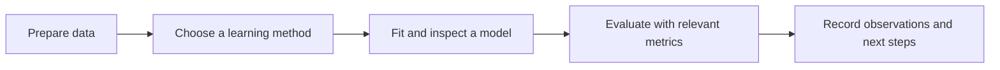

# Machine Learning Revision


A collection of Jupyter notebooks and Python exercises for revisiting data preparation, evaluation metrics, regression, classification, and unsupervised-learning concepts.

## Learning index

| Path | Topics |
| --- | --- |
| [Data_Processing.ipynb](Data_Processing.ipynb) | Label encoding, one-hot encoding, and feature scaling |
| [EvaluatingModel.ipynb](EvaluatingModel.ipynb) | Classification metrics, confusion matrix, and regression error metrics |
| [Regression.ipynb](Regression.ipynb) | Linear and logistic regression, K-nearest neighbors, and decision trees |
| [MlRevision/](MlRevision/) | Additional revision notebooks |
| [ML Project 1/](ML%20Project%201/) | Project and unsupervised-learning notebooks |
| [panadas.py](panadas.py) | Python practice file |

## Study workflow



These are study notes rather than a packaged library or end-to-end application. Some cells are exercises in progress and may need edits before they run.

## Get started

```bash
 git clone https://github.com/Sameer-ship-it/MachineLearning_Revision.git
 cd MachineLearning_Revision
 python -m venv .venv
```

Activate the environment and install the common notebook libraries:

```powershell
.venv\Scripts\Activate.ps1
python -m pip install jupyter pandas numpy scikit-learn matplotlib
jupyter notebook
```

On macOS or Linux, activate with `source .venv/bin/activate`.

Open a notebook from the learning index. Some cells refer to datasets stored on a local machine; provide a dataset you are authorized to use and update the paths before running the cells.

## Notes

- Metrics from small examples are instructional and are not benchmark results.
- For model evaluation, use reproducible splits, suitable baselines, and metrics that reflect class balance and the cost of errors.
- This repository does not include a dependency lockfile or one project-wide training pipeline.
